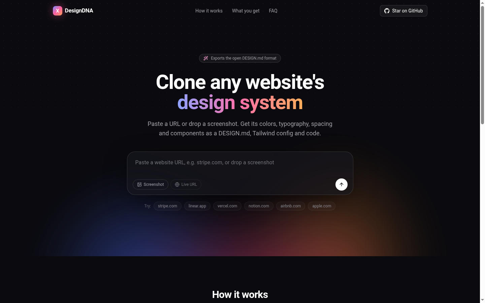
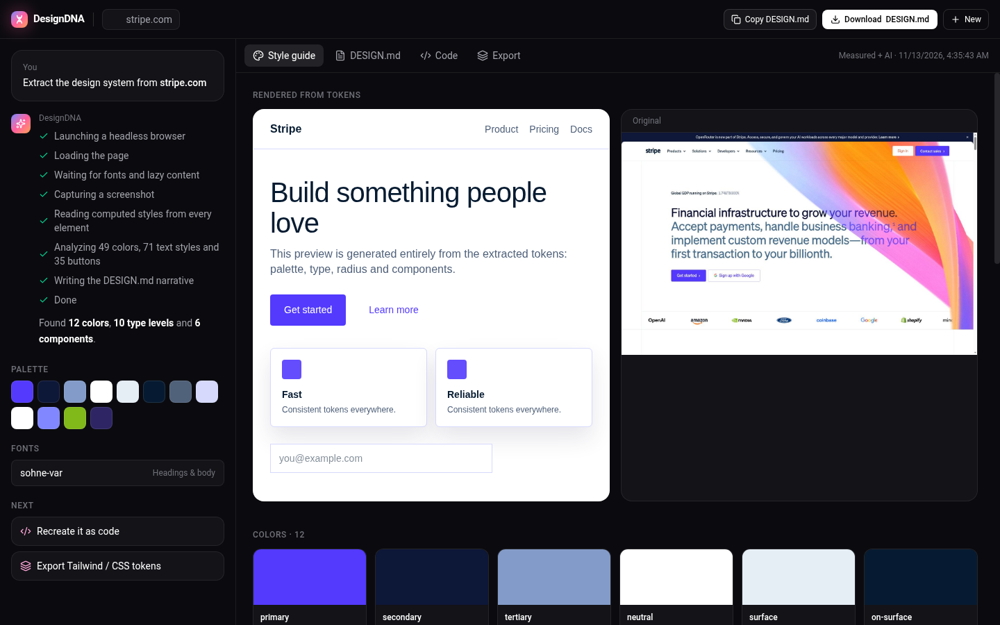
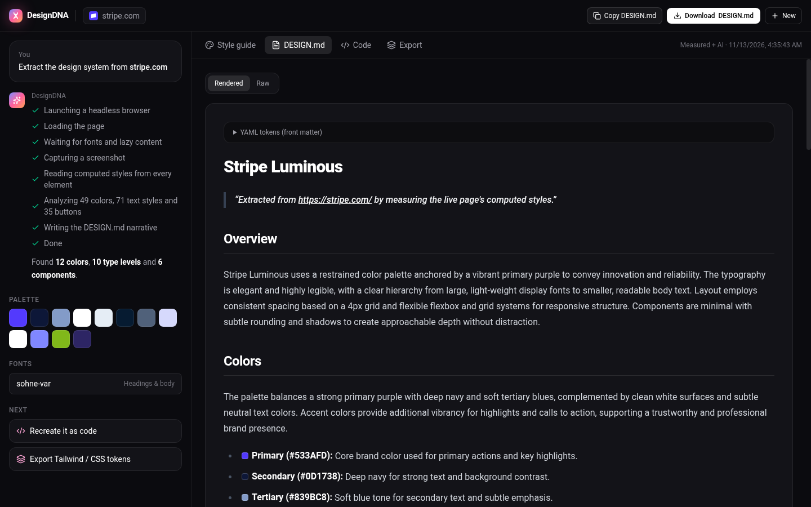

# DesignDNA

**Turn any website into a `DESIGN.md`.** Paste a URL or drop a screenshot and get the site's colors, typography, spacing, radii, shadows and components as a spec-compliant DESIGN.md, Tailwind config, CSS variables, design tokens and a recreated HTML page.

Built for students and developers who want to learn from great design, and for anyone feeding an AI coding agent (Cursor, Claude Code, v0, Lovable) a design system to follow.



## Why it's different

Most "screenshot to code" tools guess colors and sizes from pixels. DesignDNA **renders the page in a real headless browser and measures the computed style of every visible element**, so hex values, font stacks, sizes, letter-spacing and radii are exact. AI is only used to explain the system (brand personality, usage rules, do's and don'ts), never to invent values.

| | |
|---|---|
|  |  |

## Features

- **URL mode**: headless Chromium render → computed styles from ~5k elements → clustered into tokens
- **Screenshot mode**: vision model guided by a k-means palette sampled from real pixels
- **DESIGN.md** following the open [Google Stitch DESIGN.md spec](https://github.com/google-labs-code/design.md) (YAML tokens + Overview, Colors, Typography, Layout, Elevation & Depth, Shapes, Components, Do's and Don'ts)
- **Exports**: Tailwind v4 `@theme`, Tailwind v3 config, CSS variables, W3C DTCG `tokens.json`
- **Recreate as code**: streams a responsive single-file HTML + Tailwind page that uses the exact tokens
- **Live style guide** rendered purely from the extracted tokens, side by side with the original
- Works **without an AI key** (template prose); history saved locally; per-IP rate limits; SSRF guard

## How the extraction works

1. `src/lib/extract/browser.ts` loads the page (1440×900), blocks trackers, waits for fonts, scrolls to trigger lazy content, dismisses cookie banners, freezes animations and grabs a screenshot.
2. `src/lib/extract/collector.ts` runs in the page and records weighted observations: text/background/border colors (weighted by area and above-the-fold position), every text style by character count, radii, shadows, spacing, container widths, buttons (including links styled as buttons), inputs, cards, nav, headings and `:root` CSS variables.
3. `src/lib/extract/analyze.ts` clusters colors in CIELAB (ΔE), assigns roles (`primary` from the main CTA, `on-surface` from the most-used readable text, `outline` from subtle borders...), builds a type scale (display → caption), detects the 4/8px spacing grid, merges near-identical radii and emits component tokens with `{colors.primary}`-style references.
4. `src/lib/generate/*` writes the prose (AI or template), the DESIGN.md and all exports.

## Getting started

```bash
git clone https://github.com/piyush00868/design-ui.git
cd design-ui
npm install
cp .env.example .env.local   # add OPENAI_API_KEY (optional)
npm run dev
```

You need Chrome or Chromium installed locally (auto-detected). Try the extractor from the CLI:

```bash
npx tsx scripts/extract-cli.mts https://stripe.com
```

### Deploying

Works on any Node host with Chromium (Railway, Render, Fly, a VPS). On Vercel it falls back to `@sparticuz/chromium` automatically; you may need a Pro plan for the 60s function duration.

## Tech stack

Next.js 15 (App Router) · TypeScript · Tailwind CSS v4 · Puppeteer · OpenAI-compatible API · react-markdown

## Ethics

Use it to learn and get inspired. Respect trademarks and don't pass off someone else's brand as your own.

## License

MIT
